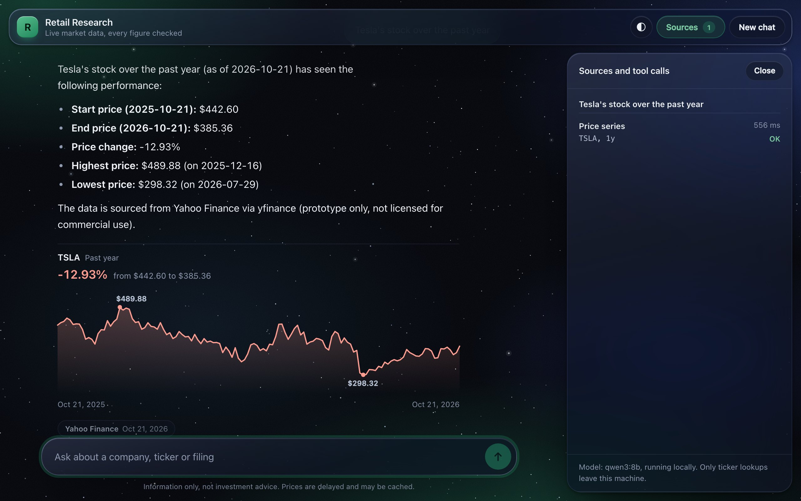
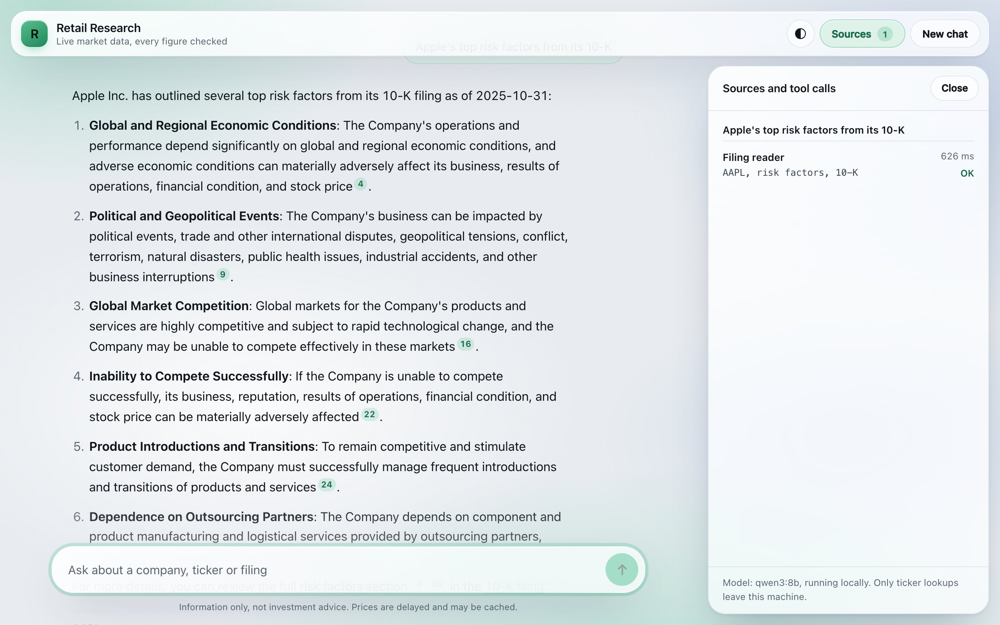
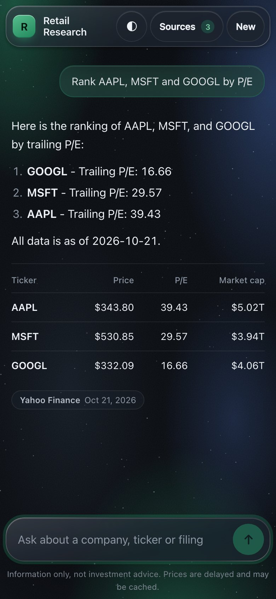

# Retail Research Agent

An investing research assistant that brokers and fintech apps can put under their own name. It looks facts up in live data, checks every number and quote it gives, and runs on a local model.


[Quick start](#quick-start) | [Features](#features) | [How it works](#how-it-works) | [White-label setup](#white-label-setup-for-brokers) | [Tests and evals](#tests-and-evals) | [Competition entry](#competition-dubai-ai-agents-championship)



## Why

A broker's support team spends much of its day answering the same factual questions: what is this stock's P/E, when was the last 10-K filed, is it above its 200-day average. Customers who want more depth get pointed to terminals that cost tens of thousands of dollars a year. A generic chatbot is worse than nothing here, because it states numbers it made up.

This agent answers those questions from live data, shows its sources and dates, refuses to give buy or sell advice, and runs on the firm's own machine, so customer questions stay inside the firm.

## Features

- Answers questions about prices, valuation, moving averages, dividends, historical closes, SEC fundamentals and filings.
- Matches every number in an answer against the data fetched for that request. Anything it can't match gets one retry, then a visible warning.
- Reads sections of 10-K and 10-Q filings, such as risk factors and management's discussion, and cites numbered passages. Each quote has to appear word for word in the filing.
- Draws price charts for periods from one month to five years (one month, three months, six months, year to date, one year, two years or five years). You can scrub them with a pointer or the arrow keys.
- Refuses buy, sell and hold questions with a check in code, then gives the facts with no recommendation.
- Runs on a local model. The server stores nothing between requests, and users never see each other's data.
- Can be white-labelled with a firm name and brand colour, embedded in an iframe, and monitored from a usage dashboard that stores counts only.
- Has Light, Dark and Space themes (plus Auto, which follows the device) and works on phones.

## Quick start

You need Python 3 and [Ollama](https://ollama.com). The model is a 5.2 GB download.

```bash
brew install ollama && brew services start ollama
ollama pull qwen3:8b

git clone https://github.com/ma67-ex/retail-research-agent.git
cd retail-research-agent
python3 -m venv .venv && ./.venv/bin/pip install -r requirements.txt

./.venv/bin/uvicorn server:app --port 8010
```

Open <http://localhost:8010> and try one of these:

- NVDA price, 200-day average and P/E
- Rank AAPL, MSFT and GOOGL by P/E
- Apple's top risk factors from its 10-K
- Tesla's stock over the past year
- Microsoft revenue and EPS, last fiscal year

There is also a command line version: `./.venv/bin/python agent.py "What's AAPL's trailing P/E ratio?"`.

Before running against SEC, set `SEC_USER_AGENT` to `"Project Name contact@yourdomain"`, because SEC asks automated clients to identify themselves.

<table>
  <tr>
    <td width="70%"></td>
    <td width="30%"></td>
  </tr>
</table>

## How it works

1. The question, plus the last few turns of the conversation (the browser keeps them), goes to a local model.
2. The model calls tools to get data.
3. Every tool result carries its source and an `as_of` date. Money values come pre-formatted (`$4.95T`), so the model copies them instead of rewriting them.
4. Before an answer goes out, code checks its numbers and quotes against that request's tool results, and answers questions about whether to buy or sell with facts only.

| Tool | What it answers | Source |
|---|---|---|
| `get_quote` | Price, 200-day average, P/E, market cap, dividend yield | Yahoo Finance via `yfinance` |
| `get_price_history` | Closing price on a past date | Yahoo Finance via `yfinance` |
| `get_price_series` | Performance over a period, drawn as a chart | Yahoo Finance via `yfinance` |
| `get_fundamentals` | Revenue, net income, EPS, shares, dividends declared | SEC EDGAR XBRL `companyfacts` |
| `get_latest_filing` | Latest 10-K, 10-Q or other filing, with date and link | SEC EDGAR submissions |
| `read_filing` | Numbered passages from a filing section | SEC EDGAR filing documents |
| `calculator` | Arithmetic on figures that came from the data | Local |

Filing quotes get the same treatment as numbers. Each quoted phrase must appear in a passage the tool returned, and the UI links each citation (like [p3]) to its excerpt.

## Configuration

Everything has a default, so none of these are required.

<details>
<summary>Environment variables</summary>

| Variable | Default | Purpose |
|---|---|---|
| `OLLAMA_MODEL` | `qwen3:8b` | Local model name |
| `OLLAMA_URL` | `http://localhost:11434/api/chat` | Ollama endpoint |
| `OLLAMA_THINK` | off | `1` turns on the model's reasoning mode (about 7x slower) |
| `SEC_USER_AGENT` | placeholder | Contact string SEC requires |
| `OFFLINE` | off | `1` serves cached tool results only (demo fallback) |
| `TRACE_LOG` | off | `1` writes a privacy-safe debug log to `trace.jsonl` |
| `FIRM_NAME` | none | White-label name shown in the UI and used in the model's instructions |
| `BRAND_COLOR` | default green | Accent colour as `#rrggbb`; anything else is ignored |
| `EMBED_ORIGINS` | same site only | Space-separated `https://host` origins allowed to embed the chat in an iframe |
| `ACCESS_TOKEN` | none (open) | A shared secret required in the `X-Access-Token` header for `/chat`. The chat page asks for it once and keeps it for that browser tab only. Not user accounts: everyone with the token has the same access |
| `RATE_LIMIT_DB` | in memory | Path of a SQLite file. Set it and every worker process shares one 20-requests-a-minute-per-client limit instead of each keeping its own |
| `STATS_TOKEN` | none | Required in the `X-Stats-Token` header for `/stats`; without it, `/stats` answers only direct local requests |
| `MINUTES_SAVED_PER_QUESTION` | `3` | Assumption behind the "estimated minutes saved" figure on the stats page |

</details>

## White-label setup (for brokers)

1. Set `FIRM_NAME` and `BRAND_COLOR`. The header becomes "<Firm> Research", and the model introduces itself as the firm's assistant and says it is not a firm employee.
2. Embed the chat in the firm's app or site with an iframe pointing at `/?embed=1`, a compact layout without the tool-call panel. List the app's origin in `EMBED_ORIGINS`; the browser blocks every other site from framing it.
3. Watch usage at `/stats/dashboard` (open it with `#token=<STATS_TOKEN>` when a token is set). It shows questions answered, the share answered with live data and with fully verified numbers, advice questions deflected, cache hits, errors, latency, and an estimate of support time saved along with the assumption behind it. It stores counts only, with no question text, answers, tickers or IP addresses, and the counts reset when the server restarts.

Customers can pick Auto, Light, Dark or Space from the appearance button in the header, and the browser remembers the choice. The UI honours reduced motion, reduced transparency and increased contrast settings.

## Privacy and security

- The server stores nothing between requests. Conversation memory lives in the user's browser tab and disappears when the tab closes.
- Each request keeps its own tool log in memory, so concurrent users never see each other's data.
- The model runs locally, so questions never reach an AI vendor. Only ticker symbols go out, to Yahoo Finance and SEC EDGAR.
- An optional debug log (`TRACE_LOG=1`) records tool names and timings, never the question text.
- Every response carries security headers: a Content-Security-Policy that allows only the app's own scripts and data, `frame-ancestors` limited to the allowed embed origins, `nosniff`, and no referrer.
- Requests are validated and rate limited, and errors always come back as JSON.

## Data sources and licensing

| Data | Source | Commercial use |
|---|---|---|
| Prices, P/E, market cap, dividends, history, price charts | Yahoo Finance via `yfinance` | Not licensed for commercial use. Prototype only; a production version needs a licensed price feed. |
| Revenue, net income, EPS, shares, dividends declared | SEC EDGAR XBRL `companyfacts` | Free to access and reuse |
| Filing links and dates | SEC EDGAR submissions | Free to access and reuse |
| Filing text (risk factors, management's discussion, business, legal proceedings) | SEC EDGAR filing documents | Free to access and reuse |

## Tests and evals

```bash
./.venv/bin/python tests/test_tools.py           # tool unit tests, offline
LIVE=1 ./.venv/bin/python tests/test_tools.py    # plus live network checks
./.venv/bin/python tests/test_agent.py           # agent + server tests, stubbed model
./.venv/bin/python tests/test_business.py        # branding, stats, access control, security headers
./.venv/bin/python evals.py --runs 3             # live end-to-end evals with pass rates
```

There are 29 eval cases, and 18 of them have a second phrasing of the same question. They check the final answer text as well as the tool output, against stored fixtures or values computed separately from the tools under test. Some live values still come from Yahoo, the same source the tools use, and filing quotes are checked against the filing text downloaded straight from SEC. The model runs at temperature 0 with a fixed seed, so an identical question gives the same output; extra runs add coverage only by alternating the phrasings.

## Project layout

```
tools.py        data tools, calculator, offline cache, tool schemas
agent.py        model loop, number and quote verification, advice guardrail
server.py       FastAPI: /chat, /config, /stats, limits, security headers, JSON errors
static/         chat UI (index.html), usage dashboard (stats.html), shared theme (theme.css, theme.js)
tests/          unit tests (no model needed)
evals.py        live end-to-end evals
docs/           screenshots used in this README
```

## Known limitations

When the agent answers from the offline cache, the code now appends a plain note with the cache date if the model's own sentence did not say so.

- The model is an 8B local model and still makes mistakes, which is why answers are number-checked and the evals report pass rates.
- The number check accepts any correct rounding of the data, so "$5T" passes for $4.95T while "39.3" for a P/E of 38.93 is flagged. Numbers the model works out in its head without the calculator are flagged even when right.
- Filing sections that only point elsewhere, such as a management's discussion incorporated by reference or a legal proceedings item that says "see Note X", come back as a single short passage.
- A company that moved to a new SEC registrant has no 10-K under its new number until it files one (Exxon Mobil in 2026, for example).
- Price data is delayed and comes from an unlicensed source (see above).
- The rate limiter counts per client IP address. Behind a reverse proxy every visitor shares the proxy's address unless the proxy enforces its own limit.
- There are no user accounts. `ACCESS_TOKEN` gives one shared secret for the chat; without it, run on localhost or behind a proxy with access control.

## Competition: Dubai AI Agents Championship

Rules: dubaichamberdigital.com/en/create-ai-agents. The submission (prototype, pitch deck, demo video) is due January 2027, and the Grand Final in May 2027 needs a fully working agent demonstrated live. The entry is in the Best Business AI Agent category.

The pitch:

- The customers are brokers, banks and fintech apps with retail investors.
- Repetitive factual questions eat support time, and generic chatbots make up numbers, which a regulated firm cannot risk.
- The firm embeds a branded assistant in its own app. It looks facts up live, checks every number and quote against its data, cites sources and dates, and refuses buy or sell advice through a check in code as well as in the prompt.
- The stats dashboard reports questions answered, the share fully verified, advice questions deflected and estimated support time saved, without storing anything about individual customers.
- The model runs on the firm's own hardware, so customer questions never reach an AI vendor, and `evals.py` shows how the agent is tested.
- The path to production is licensed price data (paid for from the grant), single sign-on in front of the chat, and a larger local model for harder questions.

<details>
<summary>Rule checklist</summary>

- [x] Original work, not copied from an existing repository (git history is the record).
- [x] Idea/prototype/early-MVP stage.
- [x] Protects personal data and prevents leakage: stateless server, per-request isolation, local model, no question text in logs, with a concurrency test that checks users can't see each other's data.
- [x] Materials in English.
- [ ] Registration, done by each team member individually.
- [ ] Pitch deck and demo video.
- [ ] Licensed price data before any commercial launch.

</details>

## Contributing

Run the three unit test suites before opening a pull request, and run `evals.py` if you change `agent.py`, the prompts or a tool, because a small prompt edit can change what the model does. Keep new tools small, make them return a `source` and an `as_of` date, and add eval cases for them.

## License

No license has been chosen yet, so all rights are reserved until one is added.

Not investment advice. This project provides information only.
